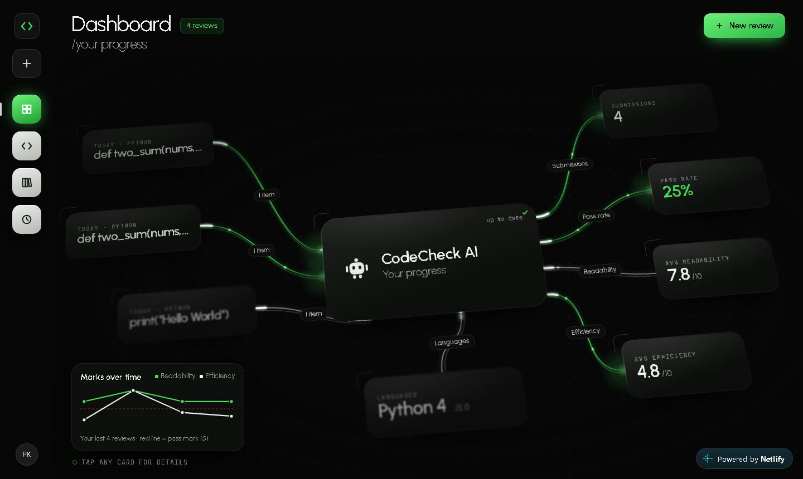
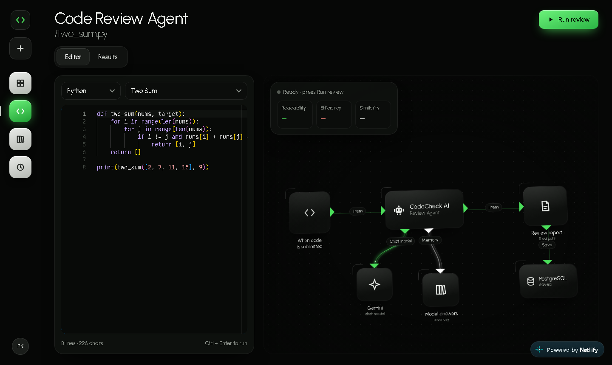
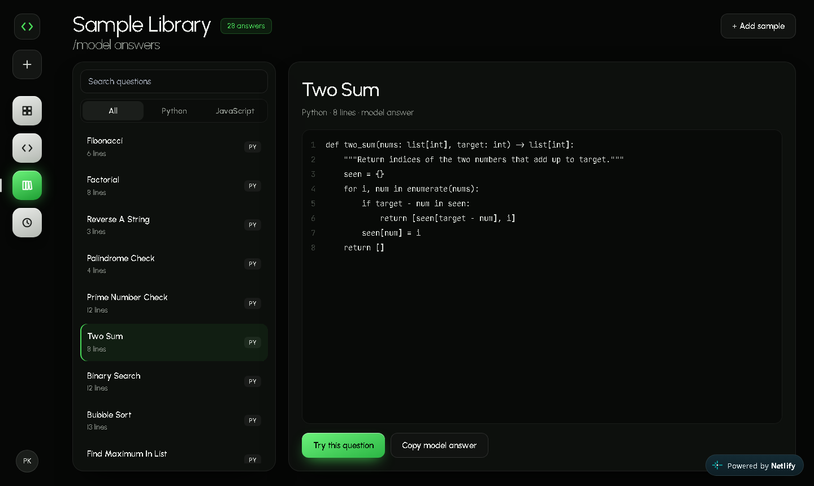
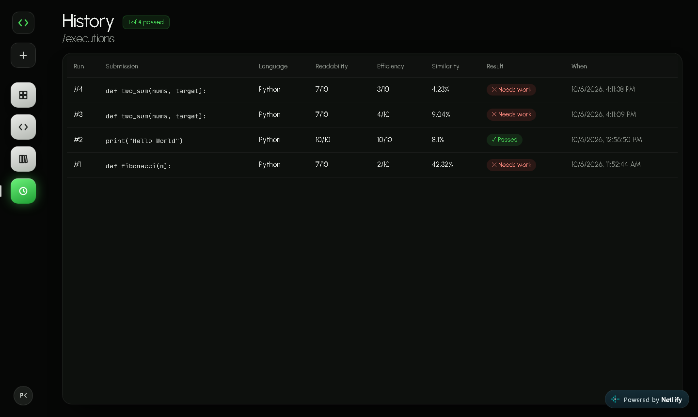
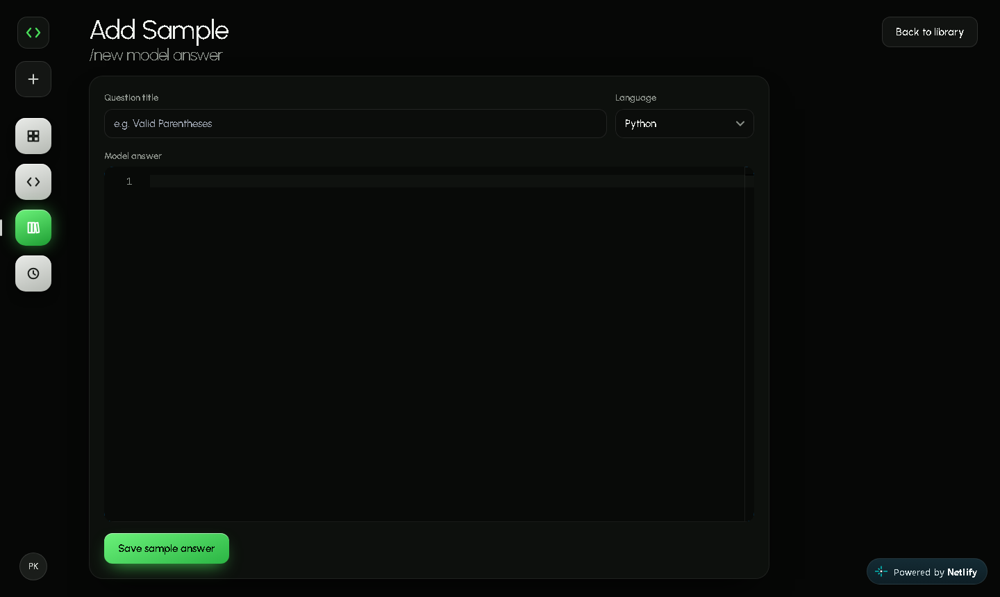

# 🤖 AI Code Reviewer (CodeCheck AI)


CodeCheck AI is a web application where you submit code in one of ten programming languages and an AI review agent, powered by Google Gemini, returns **bugs**, **suggestions**, **readability** and **efficiency** scores, a **similarity score** against a model answer, and an **improved version** of your code. Every review is saved, and your progress is shown on an animated dashboard.

---

## 🌐 Live Demo

🚀 **[codereviewer8.netlify.app](https://codereviewer8.netlify.app/)**

> The backend runs on Render's free plan, so the first request after a while can take up to a minute while the server wakes up.

---

## 📸 Screenshots

<div align="center">
<table>
  <tr>
    <td colspan="2"></td>
  </tr>
  <tr><td colspan="2" align="center"><strong>Dashboard</strong>: your real stats as an animated agent graph. Tap any card for details.</td></tr>
  <tr>
    <td></td>
    <td></td>
  </tr>
  <tr>
    <td align="center"><strong>Mark code</strong>: editor and live review workflow</td>
    <td align="center"><strong>Sample library</strong>: model answers</td>
  </tr>
  <tr>
    <td></td>
    <td></td>
  </tr>
  <tr>
    <td align="center"><strong>History</strong>: every review, expandable</td>
    <td align="center"><strong>Add sample</strong>: new model answers</td>
  </tr>
</table>
</div>

---

## 🧠 Features

- **Ten languages**: Python, JavaScript, TypeScript, Java, C++, C#, Go, Rust, PHP and Ruby, with starter code, Monaco syntax highlighting, file extensions and language badges
- **Verified email and password sign-in**: enter an email and choose a CodeCheck password, then confirm the six-digit code sent to that inbox. No account/session is created before verification. Salted scrypt hashes, revocable sessions and login/code attempt limits protect accounts. Provider app registration is not required.
- **Private accounts and owner access records**: reviews, custom samples and chats belong to their user. Only the owner can open User access to see account emails, first/last sign-ins, last active time and sign-in history. A private one-use setup link assigns the owner role; the first visitor never becomes the owner. Previous anonymous review/chat history is preserved for that owner.
- **Owner-only blocking**: the User access page shows Active/Blocked status with Block and Unblock controls. Blocking revokes every session/access token for that account and cancels pending inbox verification. Its history stays saved. Blocked accounts cannot sign in, restore sessions or use protected APIs; unblocking requires a fresh sign-in. The owner's account cannot be blocked. These permissions are enforced on the backend.
- **Review agent**: submit code and Gemini reviews it like a senior engineer
- **Custom code**: the first option opens a blank editor in any of the ten languages. Paste your own program and optionally describe its expected behavior. The review explains bugs, missing requirements and proposed fixes; applying a correction preserves your custom task. Custom reviews do not use a practice question or reference similarity.
- **Scores**: readability and efficiency out of 10. Reviews pass only with a complete correctness assessment, no bugs or missing requirements, and both scores at least 5. These are static AI judgments, not executed test results.
- **Bugs and suggestions**, with lines the AI mentions highlighted in the editor
- **Improved version** of your code, ready to copy or apply directly to the editor without copy/paste indentation changes. Unchanged code shows a clear message and no Apply button.
- **Top AI score badge**: requires an explicit correctness assessment and reason, valid 10/10 scores, all issue arrays and a complete corrected program, with no reported issues. Incomplete replies cannot pass. Editing code or starting another review cancels its pending response and clears previous scores. Scores are never increased because code matches a reference or was AI-generated. Full marks do not prove correctness or that test cases passed.
- **Structured AI responses**: the maintained `google-genai` SDK requests JSON matching a schema, which the backend validates before assigning results. Legacy Markdown reviews remain readable; incomplete legacy results do not count as passing.
- **Usage protection**: at most 20,000 source characters and 4,000 requirement characters per review. Database-backed limits default to five reviews and ten chat messages per minute per account, with at most two AI calls in flight per account. Provider quotas apply separately. Failures release request slots and never save invented reviews or answers.
- **Normalized similarity**: ignores formatting, comments and supported demonstration entry points. Python uses its syntax tree and ignores docstrings and function annotations. Strings, indentation structure and substantive logic remain significant. A 100% similarity score means the normalized representations match; equally good algorithms can still receive different similarity scores.
- **Animated workflow**: the review pipeline (trigger → agent → Gemini + model answers → report → database) animates while the AI works
- **Dashboard**: real stats from the database as a node graph with flowing wires, a marks-over-time chart and a dynamic language breakdown
- **Day/night appearance**: the toggle beside New review switches the app, graphs, chatbot and Monaco editors between light and dark palettes. The browser remembers your preference and keeps it consistent across tabs.
- **Sample library**: 50 built-in model answers (five per language), with problem requirements, search, language filters and "Try this question". Selecting a question loads its matching sample into the editor; "Load sample code" restores it after edits. Includes collections, text processing, binary search, bracket validation and language-specific tasks such as JavaScript debounce, TypeScript generic selectors, C# LINQ grouping and C++ in-place deduplication. Missing built-ins are added on startup without replacing existing answers.
- **Add sample answers** and **submission history** with expandable reviews
- **Card details on hover**: moving over a graph card or focusing it opens its details. Clicking or tapping can keep the details open; Escape closes them. Supports keyboard navigation and reduced-motion settings.
- **Assistant with chat history**: the bottom-left chat button opens a Gemini assistant for code and general questions. Start new conversations, reopen saved ones from History, and continue them after refreshing. Messages are stored in the backend database; replies receive the latest 20 messages from the selected conversation as context.
- **Delete chat history**: use the trash icon beside a conversation or Clear all in the chatbot's History tab. Confirm to permanently remove the selected chats and their messages. Review submissions and sample answers are kept separately.
- Clear error messages, for example when the free AI limit is reached or the server is waking up

---

## 💡 Tech Stack

**Frontend** (deployed on **Netlify**)

- React 19 + Vite, React Router
- Monaco Editor (the editor used in VS Code)
- Axios
- Custom CSS design system (`src/styles/app.css`) and an SVG node-graph engine (`src/lib/graph.js`)

**Backend** (deployed on **Render**)

- FastAPI + Uvicorn
- SQLAlchemy with PostgreSQL on **Neon** (SQLite when running locally)
- Google Gen AI SDK (`google-genai`), with a configurable Gemini model

---

## 📁 Project Structure

```
AI-Code-Reviewer/
├── Backend/                    # FastAPI backend
│   ├── app/
│   │   ├── main.py             # API endpoints
│   │   ├── ai_utils.py         # Gemini prompt + response parsing
│   │   ├── models.py           # Database tables
│   │   ├── schemas.py          # Request/response models
│   │   └── database.py         # Database connection
│   └── requirements.txt
├── Frontend/                   # React + Vite frontend
│   ├── src/
│   │   ├── components/Rail.jsx # Left navigation
│   │   ├── lib/                # api.js, graph.js, editorTheme.js
│   │   ├── pages/              # Dashboard, SubmitCode, SampleAnswerList,
│   │   │                       # AddSampleAnswer, SubmissionHistory
│   │   ├── styles/app.css      # Design system
│   │   └── App.jsx
│   └── vite.config.js
├── docs/screenshots/           # README screenshots
├── netlify.toml                # Netlify build settings
├── render.yaml                 # Render deployment settings
└── README.md
```

---

## 🔌 API

| Method | Endpoint | Purpose |
|---|---|---|
| POST | `/submit-code` | Review code with Gemini and save the result |
| POST | `/add-sample-answer` | Add a model answer |
| GET | `/sample-questions` | List model answers |
| GET | `/submission-history` | List past reviews |
| POST | `/chat/messages` | Ask the assistant or continue a saved conversation |
| GET | `/chat/conversations` | List saved conversations |
| GET | `/chat/conversations/{id}` | Read a conversation and its full message history |
| DELETE | `/chat/conversations/{id}` | Delete one conversation and its messages |
| DELETE | `/chat/conversations` | Clear all chat conversations and messages |
| GET | `/auth/config` | Public sign-in availability |
| POST | `/auth/register` | Request an inbox code; no account/session yet |
| POST | `/auth/login` | Sign in with an email and password |
| POST | `/auth/verify-email` | Consume the inbox code, verify the email and create a session |
| POST | `/auth/resend-verification` | Send a fresh code after the cooldown; invalidate the old code |
| GET | `/auth/me` | Restore a session and issue a short-lived access token |
| POST | `/auth/logout` | Revoke this browser's session and access tokens |
| GET | `/admin/users` | Owner-only, paginated account/access list |
| PATCH | `/admin/users/{id}/access` | Owner-only block/unblock with `{ "blocked": true/false }` |
| GET | `/admin/sign-ins` | Owner-only, paginated sign-in history |

Interactive API docs: `/docs` on the backend.

The review, library, chat and admin APIs require a bearer access token. A session cookie alone does not authorize these APIs. User/access lists are protected on the server, in addition to the owner-only navigation.

---

## 🔧 Run Locally

### Email and password sign-in

Open the frontend, select **Create account**, and enter your real email and a new CodeCheck password of 15 to 128 characters. New passwords reject repeated patterns, keyboard/number sequences, common choices and predictable email/app-name passwords. Long passphrases are allowed without composition rules. Enter the six-digit code delivered to that inbox to finish creating the account. The password belongs to CodeCheck; the app does not validate or collect your normal email-provider password. Returning verified users choose **Sign in** with the same CodeCheck credentials. Google, GitHub and Microsoft app registration is not needed.

**Configure the verification-email sender**

```powershell
cd Backend
.\venv\Scripts\python.exe setup_email.py
```

The local helper opens the provider settings, accepts hidden sender credentials, checks a secure SMTP login, and saves `SMTP_HOST`, `SMTP_PORT`, `SMTP_SECURITY`, `SMTP_USERNAME`, `SMTP_PASSWORD` and `SMTP_FROM` in `Backend/.env`. For Gmail, enable 2-Step Verification and create a separate [Google app password](https://support.google.com/accounts/answer/185833); never paste your normal Google password. Other providers can use their SMTP credentials with SSL or STARTTLS. Restart the backend after setup. Configure the same sender settings in the hosted backend environment when deploying.

To select your Gmail account directly, run `.\venv\Scripts\python.exe setup_email.py --gmail-address sender@gmail.com` with your own sender address. The Google page opens for that account. Name the app **CodeCheck AI**, choose **Create**, and paste the app password into the helper's hidden prompt. Google displays this password on the page; it does not email it to you.

Verification is mandatory: missing/failed email delivery blocks account activation. No development mode returns codes to the browser or logs. Codes expire in ten minutes, allow five attempts, are single-use, and are replaced when a code is resent after the one-minute cooldown. The database stores only a hash of the code tied to the high-entropy challenge and the salted password hash. Pending requests alone cannot access reviews, chat or owner records.

Existing email/password accounts remain unverified until their inbox is confirmed. Their old session/access tokens cannot bypass this check. Sign in with the existing password to request a code. If an address was previously registered without verification, the real inbox owner can use Create account to choose the final password; verification invalidates earlier sessions while preserving the account's data. Owner permission still requires the private owner link. Fake/test inboxes cannot complete verification.

Passwords are salted and hashed with scrypt (N=131072, r=8, p=1); plaintext passwords are never saved or returned. Sign-in attempts are limited by account and source address in the database. Account emails are normalized for case-insensitive uniqueness. A matching email from an old provider account does not grant access to that account.

**Set up the owner's private access page**

Run this once from the backend terminal connected to the app's database:

```powershell
cd Backend
.\venv\Scripts\python.exe setup_owner.py --open
```

The browser opens a private, single-use link. Choose the owner's real email and CodeCheck password, or switch to Sign in if that account already exists, and complete inbox verification when required. The owner role and previous anonymous data are assigned only after verification. The link expires after one hour. Other visitors can create accounts normally but cannot claim ownership. Never share the owner setup link. If an owner already exists, this command refuses to replace it.

For a hosted backend, run `python setup_owner.py --origin https://codereviewer8.netlify.app` in its server terminal, then open the private link it prints. This must use the same database as the deployed backend. Ownership is pinned to the account's internal identity, independently of a user-supplied email address. The owner can view **User access** from the profile menu or sidebar shield. Previous anonymous reviews, chats and custom samples are assigned only to this owner.

If mandatory inbox verification locks out an owner who was already pinned before mail setup, a trusted backend operator can run `python setup_owner.py --restore-access --email owner@example.com`. It approves access only for that exact existing owner identity and keeps the existing password. It cannot create an owner, approve visitors, or transfer ownership by matching an email. This local approval is stored separately from inbox verification: `email_verified` remains false until the inbox is actually confirmed. New users still need an inbox code. There is no public owner-recovery endpoint.

### Deploy sign-in with Netlify and Render

- Configure `APP_ENV=production`, `ALLOWED_ORIGINS=https://codereviewer8.netlify.app`, the SMTP sender settings, the Gemini key and a persistent PostgreSQL `DATABASE_URL` on the backend. Other actual frontend origins can be listed with commas. No OAuth client IDs or secrets are required for email/password login. SMTP uses SSL on port 465 or STARTTLS on port 587 by default; plaintext SMTP is not supported.
- Set Netlify's `VITE_API_BASE_URL` to the HTTPS backend origin and rebuild. The build generates the `/auth/*` proxy, keeping the HttpOnly session cookie on the frontend origin. Other API requests go directly to the backend to preserve their longer AI timeout.
- Short-lived access tokens stay in browser memory. Only token hashes are stored in the database. Sign-out revokes the current browser session. Sessions last seven days; access tokens last ten minutes.
- Back up the existing database before deployment. Startup adds tables/ownership columns without deleting existing rows. Reviews and chats remain private to their account; built-in samples stay shared.
- The previous provider endpoints remain for existing installations; the login screen uses email/password only.

### Backend

```bash
cd Backend
python -m venv venv
venv\Scripts\activate          # macOS/Linux: source venv/bin/activate
pip install -r requirements.txt

# Backend/.env
# GEMINI_API_KEY=your-api-key
# GEMINI_MODEL=models/gemini-flash-lite-latest   (optional)
# DATABASE_URL=postgresql://...                  (optional, SQLite is used without it)

venv\Scripts\python.exe -m uvicorn app.main:app --reload --port 9055
```

### Frontend

```bash
cd Frontend
npm install

# Frontend/.env
# VITE_API_BASE_URL=http://localhost:9055  (optional for local development)

npm run dev
```

Get a free Gemini API key at [aistudio.google.com/apikey](https://aistudio.google.com/apikey).

The local frontend defaults to `http://localhost:9055`. For deployment, set `VITE_API_BASE_URL` to the hosted backend URL before building. Gemini calls use HTTPS with a 60-second timeout and no automatic retries; quotas and model availability depend on your Google project.

Backend regression checks (no external AI requests):

```powershell
cd Backend
.\venv\Scripts\python.exe -m unittest discover -s tests -v
```

---

## Validation and release checks

Run the application regressions from `Backend` with `venv\Scripts\python.exe -m unittest discover -s tests`. From `Frontend`, run `npm run build` and `npm run lint`.

The [evaluation notes](Backend/evaluation/README.md) explain the real-Gemini benchmark, its partial results and the observed false alarm. Keep this distinction in project demonstrations: code similarity and full AI scores do not mean tests were executed.

Run `venv\Scripts\python.exe check_readiness.py` from `Backend` to check configuration without printing secrets or sending email. Add `--site https://codereviewer8.netlify.app` to check the deployed sign-in proxy. A successful `/auth/config` response must be backend JSON, not the frontend HTML. `/health` checks database connectivity without using the Gemini quota.

Before public registration works, configure a real SMTP sender using `setup_email.py`, supply the hosted backend's persistent PostgreSQL URL, set the exact HTTPS frontend origin, and rebuild Netlify with `VITE_API_BASE_URL` pointing to that backend. Local changes do not update a published deployment automatically.

### 📝 License

## MIT License © 2025 Vashu Singh, Praveen Kumar V

### Acknowledgments

- [FastAPI](https://fastapi.tiangolo.com/)
- [React](https://react.dev/)
- [Vite](https://vitejs.dev/)
- [Monaco Editor](https://microsoft.github.io/monaco-editor/)
- [Google Gemini](https://ai.google.dev/)
- [Netlify](https://www.netlify.com/)
- [Render](https://render.com/)
- [Neon](https://neon.tech/)
